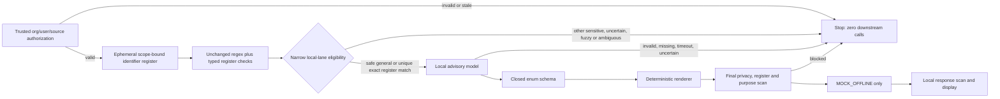

# P6 local privacy and research preflight

Date: 2026-10-24

Status: design and synthetic benchmark preregistration only. No runtime or model was downloaded, installed, or started. No provider, key, ledger, private document, Amsel data, or external AI endpoint was accessed.

## Narrow objective

P6 evaluates whether a local, advisory model can help turn an already-authorized request into a small general research intent without transmitting known identifiers or personal circumstances. It does not replace authorization or the deterministic privacy gate, grant source access, answer from private documents, route arbitrary text, or enable OpenAI. During P6, the only downstream provider remains `MOCK_OFFLINE`.

Success is deliberately narrow: improve detection/generalization for known, authorized synthetic identifiers and a defined set of clear paraphrases while preserving fail-closed behavior. The benchmark cannot establish universal privacy safety.

The current regex and a finite authorized register are both incomplete detectors. An unregistered sensitive expression that the regex does not recognize may still look `safe` to the new lane; the advisory model is not proof that it is harmless. P6 reports that blind spot explicitly and makes no claim to detect every unknown person, circumstance, or sensitive category.

## Fixed data flow

1. **Authorize first.** Trusted host code resolves organization, user, purpose, task, and requested sources. Revoked access, tenant mismatch, stale authorization, or an unsupported purpose stops with zero model and provider calls.
2. **Build a scope-bound identifier register.** Only identifiers found in the currently authorized sources are included. Entries carry organization, source, authorization-version, type (`person_name`, `postal_address`, or `email`), and normalized matching forms. The register is sensitive local data, exists only in memory for the request, is never logged or sent to a browser/provider, and confers no permission.
3. **Run deterministic checks in a separate local-research lane.** The existing external-agent regex and decisions remain unchanged as the baseline. In the new lane, a uniquely and exactly register-confirmed name or direct identifier may continue locally despite `BLOCK_DIRECT_PERSON_NAME` or a redactable result, and safe general text may continue locally. Fuzzy matches, short aliases, ambiguous identities, unregistered names, and every other sensitive or uncertain privacy category stop before the model. This is not a general exemption for text classified as sensitive.
4. **Ask the local advisory model.** Only after authorization and the narrow eligibility check, the original request and authorized local register may be supplied to the fixed local model. The model can return only the closed schema below. Missing runtime, timeout, malformed output, uncertainty, refusal, or any extra field fails closed with zero downstream calls.
5. **Render deterministically.** Trusted code maps enums to a fixed general query. The model cannot emit free text, quotes, names, circumstances, source IDs, URLs, tools, or instructions.
6. **Scan again.** The rendered query passes the complete existing privacy classifier, the current scope-bound register, purpose policy, and closed request validation. Any match or uncertainty stops.
7. **Call only the offline mock.** A safe general query may reach `MOCK_OFFLINE`. There is no OpenAI or other cloud fallback.
8. **Merge locally.** The mock response is untrusted and scanned before trusted local code may display it beside the authorized original context. The response cannot create permissions or actions.

User consent, a model `safe` decision, or successful pseudonymization never bypasses source authorization, organization scope, purpose policy, register matching, or the final scan.



## Closed local-model contract

The adapter accepts an internal object containing the authorized original request, the allowed task/purpose enums, and only the authorized documents and register entries for the same organization and authorization version. It binds to one fixed loopback URL and one pinned model manifest. Browser code cannot call it.

The first implementation supports one research intent only. The only positive output is exactly:

```json
{
  "schemaVersion": 1,
  "decision": "generalize",
  "researchIntent": "WORKING_TIME_CHANGE",
  "jurisdiction": "DE",
  "language": "de"
}
```

Allowed enums:

- `decision`: `generalize`, `block`, `uncertain`
- `researchIntent`: only `WORKING_TIME_CHANGE`
- `jurisdiction`: only `DE`
- `language`: `de` or `en`

Only `decision: generalize` continues. No optional or additional fields are accepted. Both allowed languages render the same single outbound text: `General information about changing contractual working hours in Germany.` Unsupported combinations stop. The outbound prompt, metadata, history, tools, and logs contain no original quote, name, number, actor/organization ID, candidate, or match score. The local model never supplies provider text.

## Identifier-register matching contract

- Person names, person aliases, addresses, and the text searched for them use Unicode NFKC, type-appropriate case-folding and collapsed whitespace without transliterating across scripts. `person_alias` is an explicit typed alias of one subject; it does not grant fuzzy matching to initials.
- Email is the deliberate exception to global case-folding: normalize Unicode and surrounding whitespace, lower-case the domain only, and keep the local part byte-for-byte case-sensitive.
- Address matching may normalize common punctuation and whitespace, but not silently remove house numbers or unit markers.
- Person-name exact matching uses full normalized tokens. Fuzzy matching is limited to full multi-token names above a minimum length, at most one edit in one token, with all other tokens exact and token order preserved.
- Single-token names, initials, words of three characters or fewer, and common time/month terms never fuzzy-match. A `contextual_short_alias` such as `Al` matches only a complete token and always returns `uncertain`; it never identifies a person automatically. Ambiguous fuzzy matches such as one edit from two registered people also return `uncertain` and block. A unique one-edit full-name candidate remains conservative `uncertain` for P6A rather than continuing to the model.
- Register entries are keyed to organization, source, purpose, user authorization version, and request lifetime. They cannot be cached or reused across tenants, users, permissions, or requests.
- A registry match keeps the original local and requires the closed generalization path. Only the fixed, identifier-free renderer output may continue. Ambiguous identity, unsafe context, or any remaining match blocks without revealing candidates.

The shared development register is built only from authorized source `lab-workingtime-note` for organization `lab-org-a`, actor `lab-actor-a`, and session `lab-session-1`. It contains the synthetic person `Talea Fantasie`, alias `T. Fantasie`, email `talea@verein.invalid`, address `Beispielbogen 84, 00000 Musterort`, and distinct person `Talia Fantasie`. Short alias `Al` is contextual and never a global match. `lab-private-note` belongs to `lab-org-b` and must never contribute entries or privileges.

Every asynchronous local-model operation captures an opaque generation containing organization, actor, session, source-authorization version, and monotonically increasing request generation. The same live state is revalidated immediately before any mock call and again before display. Switching A→B→A never makes an old A generation current merely because IDs match again.

The existing name regex is not broadened merely to improve this benchmark; regex-only remains a separately reported baseline.

## Threat boundaries

| Threat | Required behavior |
| --- | --- |
| Cross-tenant or revoked-source reuse | Reject before register/model construction; zero downstream calls |
| Register disclosure or privilege escalation | Memory-only, typed, scope-bound, no logs/browser/provider; never grants access |
| Fuzzy false positive | Strict length/type limits; ambiguous result blocks and is reported separately |
| Fuzzy false negative | Final local model plus complete post-render scan; residual uncertainty blocks |
| Prompt injection in a document | Document is data; model output is closed enums; renderer and final checks remain authoritative |
| Model returns prose, quotes, person details, URLs, tools, extra keys, or invalid enums | Reject entire output; zero downstream calls |
| Local runtime missing, busy, timed out, or unreachable | Fail closed; no direct cloud/OpenAI fallback |
| Local service exposed beyond loopback | Refuse startup/use unless exact `127.0.0.1:11435` binding is verified |
| Model/tag drift | Verify release archive SHA-256 and exact model manifest/layer digests before use |
| Untrusted mock answer | Scan and merge only locally; answer cannot authorize actions or sources |

## Preregistered benchmark

[P6-BENCHMARK-PLAN.json](P6-BENCHMARK-PLAN.json) freezes the ten independently supplied development fixtures Q01–Q10 before implementation. Six additional holdout cases Q11–Q16 remain withheld by the independent reader until the first implementation candidate is frozen; their text must not be sought or inferred. The benchmark compares three distinct configurations:

1. current regex only;
2. regex plus exact/fuzzy scope-bound register;
3. regex plus register plus fixed local Qwen adapter and deterministic renderer.

Metrics are reported on three separate axes: identifier recognition, outbound leakage, and narrow research utility. Each case records the deterministic decision, ambiguity, local-model call count, external mock-call count, exact outbound text, schema validity, stale-generation stop, and latency. No population-level accuracy or universal-safety percentage is calculated. Regex results remain visible rather than being overwritten by later stages. The preregistered, pre-implementation result of the unchanged classifier is stored in [P6-REGEX-BASELINE.json](P6-REGEX-BASELINE.json), bound to the benchmark-plan SHA-256. It shows where the regex already blocks, where it only redacts, and where Unicode or short-alias cases currently pass; authorization and stale-generation checks deliberately remain outside that regex-only result.

The known Q01–Q10 set becomes regression evidence once read. P1/P2 are also known regressions. Only the withheld Q11–Q16 can serve as a first holdout check, and only after candidate freeze.

## Fixed runtime and model plan

The authorized test machine is Apple M2 Pro (`arm64`) with 32 GiB RAM and approximately 1 TiB free disk. This is ample for the selected 2.5 GB quantized model plus a roughly 160 MB runtime, but measured peak memory and latency still belong in the eventual result.

### Runtime

- Official Ollama release: `v0.40.4`.
- Asset: `ollama-darwin.tgz`, 160 MB.
- Expected SHA-256: `a4ceae4b2aaf18df37ebcbfb56ba3a37a87838631112d66c2be07268693c8d58`.
- Source: [official v0.40.4 release assets](https://github.com/ollama/ollama/releases/expanded_assets/v0.40.4).
- Future location after a separate implementation gate: `.local/ollama/runtime/`; archive and checksum evidence under `.local/ollama/downloads/`. Both are already excluded through `.local/`.
- No Homebrew/system installer, macOS app install, login item, launch agent, firewall change, global PATH edit, or background service.

The future download must use the exact release URL, verify SHA-256 before extraction, reject symlinks or paths escaping the target, and record only version/digest/file-size metadata. The process starts on demand and stops explicitly; no automatic restart.

### Model

- Exact tag: `qwen3:4b-instruct-2507-q4_K_M` (non-thinking instruct variant).
- Registry metadata: 4.02B parameters, Q4_K_M, approximately 2.5 GB, Apache License 2.0.
- Full manifest SHA-256 fetched read-only on 2026-10-24: `0edcdef34593eac1aa2be9c7d06c432dcf81945adca5eca2f27662c18f168ba0` (the registry displays prefix `0edcdef34593`).
- Model layer: 2,497,280,480 bytes, `sha256:85e4a5b7b8ef0e48af0e8658f5aaab9c2324c76c1641493f4d1e25fce54b18b9`.
- License layer: 11,338 bytes, `sha256:d18a5cc71b84bc4af394a31116bd3932b42241de70c77d2b76d69a314ec8aa12`.
- Template layer: `sha256:eade0a07cac7712787bbce23d12f9306adb4781d873d1df6e16f7840fa37afec`.
- Params layer: `sha256:0914c7781e001948488d937994217538375b4fd8c1466c5e7a625221abd3ea7a`.
- Sources: [official Ollama model entry](https://registry.ollama.com/library/qwen3:4b-instruct-2507-q4_K_M) and its public registry manifest.

The future pull must use the exact tag and then verify the stored manifest and every expected digest before inference. No larger, thinking, alternate, or cloud fallback model is permitted.

### Intended process environment

After the key-side-effect blocker below is resolved, the reviewed start wrapper would set only process-local values:

```text
OLLAMA_NO_CLOUD=1
OLLAMA_HOST=127.0.0.1:11435
OLLAMA_MODELS=<repository>/.local/ollama/models
OLLAMA_KEEP_ALIVE=0
OLLAMA_NUM_PARALLEL=1
OLLAMA_MAX_LOADED_MODELS=1
OLLAMA_CONTEXT_LENGTH=4096
```

Ollama documents `OLLAMA_NO_CLOUD=1` as disabling cloud features, `OLLAMA_HOST` as the bind setting, and `OLLAMA_MODELS` as the model location: [official FAQ](https://github.com/ollama/ollama/blob/main/docs/faq.mdx). The runtime and adapter verification established the loopback address, server version, exact model digest, cloud-disabled startup log signal, and an empty external-call counter before synthetic inference. Browser code never contacts port 11435 directly.

### Confirmed pre-start blocker: global key files

The pinned v0.40.4 `ollama serve` path calls `initializeKeypair()` before `net.Listen`. It resolves the real user home, checks `~/.ollama/id_ed25519`, and, only when that path is absent, creates `~/.ollama` with mode 0755, writes the private key with mode 0600 and the public key with mode 0644, then prints the public key. The documented serve settings expose no separate identity-key path. See the exact [v0.40.4 `cmd/cmd.go`](https://github.com/ollama/ollama/blob/v0.40.4/cmd/cmd.go#L2086-L2145) and the [v0.40.4 FAQ](https://github.com/ollama/ollama/blob/v0.40.4/docs/faq.mdx#how-do-i-disable-ollama-cloud-features).

P6 does not add a custom Ollama build, key redirect, fake `HOME`, global service, or system change. The first diagnostic profile used the standard macOS `/usr/bin/sandbox-exec` to deny the entire real `~/.ollama` subtree. The accepted profile keeps that subtree denial but exempts only the directory entry and the exact `id_ed25519` and `id_ed25519.pub` paths required for the authorized first creation; every other descendant remains denied. The real home stays unchanged and the child environment is rebuilt from a small allowlist. The wrapper also refuses to start when either identity path already exists. The profile does not claim to be a general network-egress sandbox; `OLLAMA_NO_CLOUD=1`, the exact loopback bind, fixed project-local model directory, and post-start verification remain separate controls.

The pinned runtime was first run under the complete subtree denial and stopped before binding when upstream identity initialization could not create its directory. A later, explicitly authorized metadata-only check established that the directory and both key paths were absent without reading contents. The human allowed first creation of exactly those paths. Initial synthetic exception tests appeared to allow an unapproved sibling because they mixed `/tmp` with its canonical `/private/tmp` path. One independently authorized corrected test used canonical paths consistently: both approved names were writable and the sibling was denied. After independent review, the guarded real start created only the two permitted identity files and bound the cloud-disabled runtime to loopback. The exact pinned model and all referenced files were then verified. Full evidence is recorded in [P6-RUNTIME-PREPARATION.md](P6-RUNTIME-PREPARATION.md); first-run results are in [P6-LOCAL-MODEL-RESULT.md](P6-LOCAL-MODEL-RESULT.md).

## Next gated implementation slice

After review of this preflight only:

1. independently review the corrected in-memory register, private snapshots, closed schema, deterministic renderer, local adapter interface, and synthetic test doubles against the new candidate hash;
2. preserve the first holdout findings as suitability evidence rather than adding case-specific privacy words or claiming a universal classifier;
3. resolve the blocked exact-two-file runtime boundary without broadening the current deny-all profile or introducing a larger sandbox architecture;
4. only after that separate runtime gate, start on loopback with cloud disabled, load and verify the fixed model in `.local/`, and run the synthetic benchmark once;
5. report regex, register, and model results separately, including false positives, false negatives, latency, memory, disk use, and all remaining limits;
6. stop the process and preserve no prompts, original identifiers, or model output in persistent logs.

No Amsel integration, public deployment, npm publication, OpenAI call, production data, or P5 live-mode change is part of this slice.
